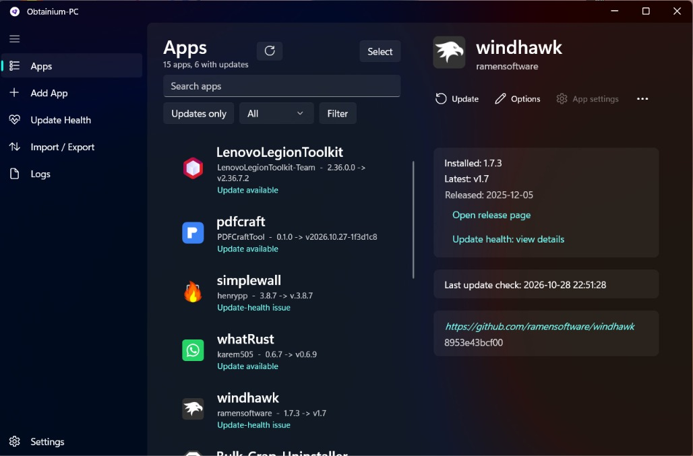
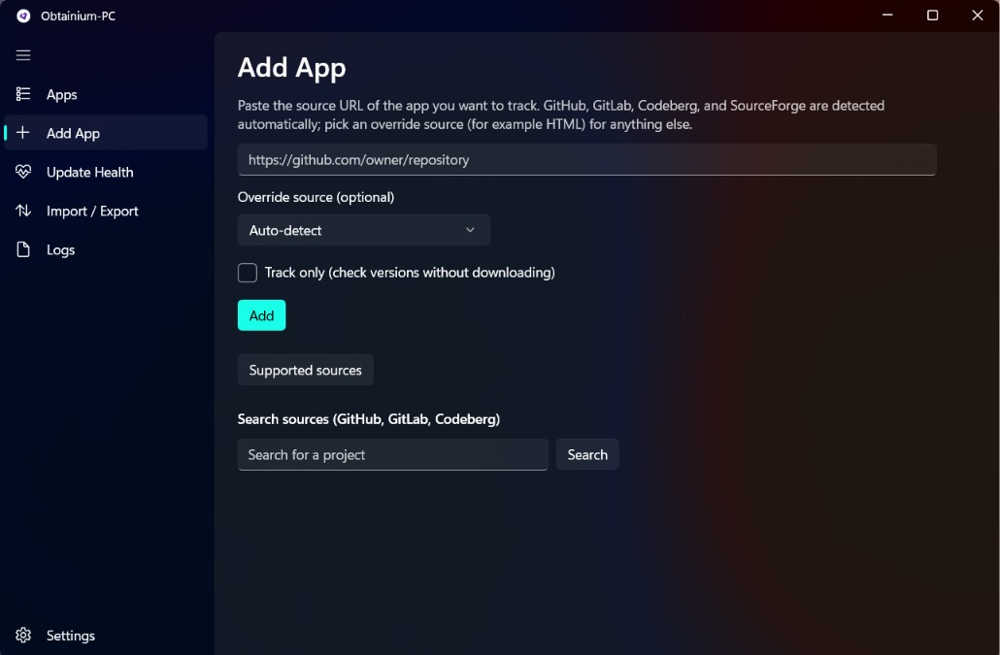
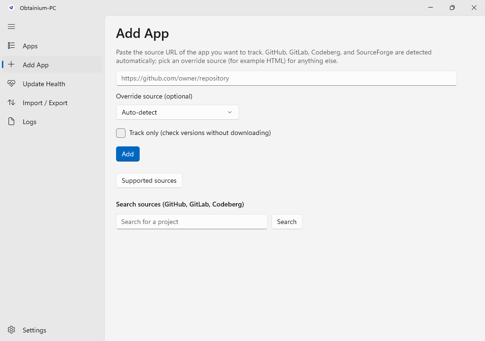
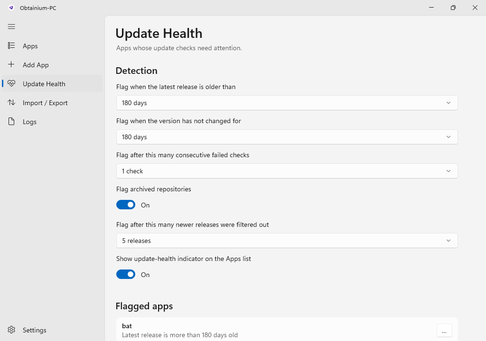
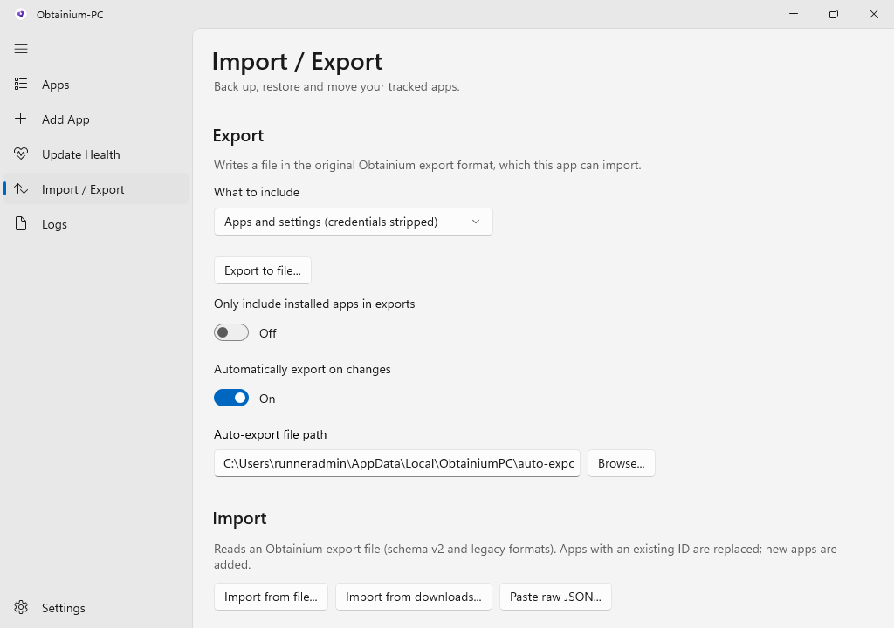
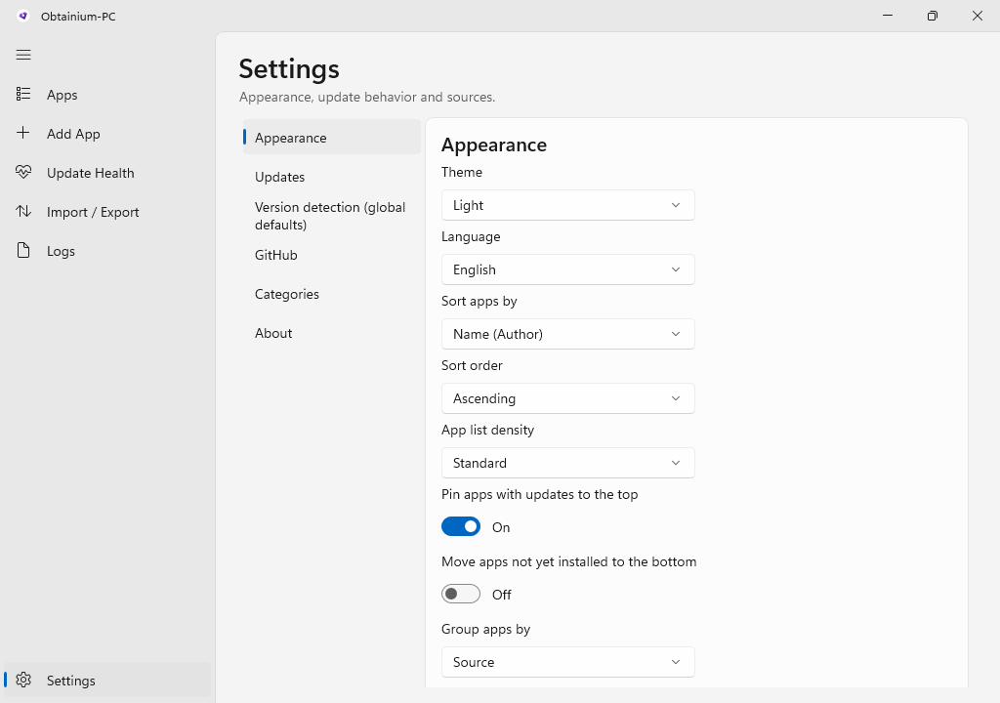

# Obtainium-PC

**Get Windows app updates straight from the source.**

Track apps by their release pages, get told when a new version is out, and download it, all from one native Windows app.

[**Download**](https://github.com/StarsDust01/Obtainium-PC/releases/latest) · [Features](#features) · [Screenshots](#screenshots) · [Known limits](#known-limits-early-access)

 

## Introducing Obtainium-PC

This is the first introductory release of Obtainium-PC for Windows, released as Early Access. It introduces the app and its features, rather than an update or a set of fixes to an earlier public version.

Obtainium-PC is a native Windows (WinUI 3) port of [Obtainium](https://github.com/ImranR98/Obtainium) by ImranR98.

## Features

| | Feature | What it does |
|---|---|---|
| ➕ | **Add by URL** | Paste a release page link. The app finds the latest release and the Windows files in it. |
| 👁 | **Track-only mode** | Follow an app's releases without installing anything through the program. |
| 🪟 | **Windows-only tracking** | Android store sources and APK-only releases are refused when adding, and Android records in an import are skipped with a note. Nothing already saved is deleted. |
| 🩺 | **Update health** | See which apps are current, outdated, unchecked or failing. Ignore or restore individual apps. |
| ⏳ | **Minimum update age** | Enforced when an update is applied. |
| 🔁 | **Download retries** | On timeouts, network errors, 429 and 5xx. |
| 🗂 | **Categories** | Group apps, and switch on "Skip update checks" for a whole category. |
| 🔋 | **Background check guards** | "Don't check on a metered connection" and "Don't check on battery power". Both are off by default and affect background checks only. Manual update checks still run. |
| 📦 | **Download size** | The detail page shows the size of the selected file when it is known. |
| 💾 | **Import and export** | Export your app list, with optional automatic export after changes, and import it back. Existing records are kept as they are. |
| 🎨 | **Look and language** | Light and dark themes, many languages including right-to-left, filter and sort, and `obtainium://` deep links. |
| 🛡 | **Visible installers** | Installers run visibly. Nothing is installed silently. |

<b>Supported sources</b>

 

GitHub, GitLab, Forgejo (including Codeberg), SourceForge, SourceHut, itch.io, Jenkins, any HTML page, and direct file links.

## Screenshots

The screenshots below come from the automated UI test run of this build, with test data.

<b>Add App</b>

 

<b>Update Health</b>

 

<b>Import / Export</b>

 

<b>Settings</b>

 

## Install

Download from the [Obtainium-PC v1.0 - Early Access](https://github.com/StarsDust01/Obtainium-PC/releases/latest):

| File | Use it when |
|---|---|
| `Obtainium-PC-v1.0-win-x64-Setup.exe` | You want the normal installer. It installs to `C:\Program Files\Obtainium-PC` and asks for administrator permission. |
| `Obtainium-PC-v1.0-win-x64-portable.zip` | You want to unzip anywhere and run `ObtainiumPC.exe`. |

Windows 10 1809 or newer, 64-bit. Not code-signed, so Windows SmartScreen may warn on first run.

## Known limits (Early Access)

<b>Read before you rely on it</b>

 

- A native crash (0xc000027b) was observed during development. It has not been reproduced in repeated stress testing and its cause is unknown. This build is not claimed to be stable.
- The metered and battery checks use Windows' own state and were not tested on a real laptop.
- Self-update was tested against a local test server and, after publishing, against the public releases of this repository.
- Some store-specific error messages are still English only.

## Credit and license

Obtainium-PC is a Windows port of [Obtainium](https://github.com/ImranR98/Obtainium) by ImranR98. All credit for the original idea, design and icon goes to the original author. This project keeps the original GPL-3.0 license (see [LICENSE.txt](LICENSE.txt)). The translation source files in `assets/translations` come from the original project.

brought to you by Instinct

